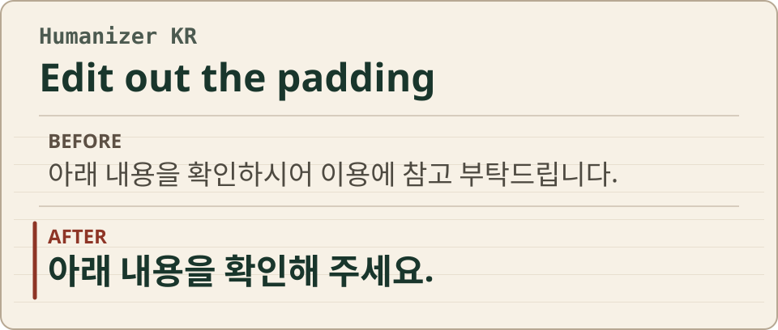
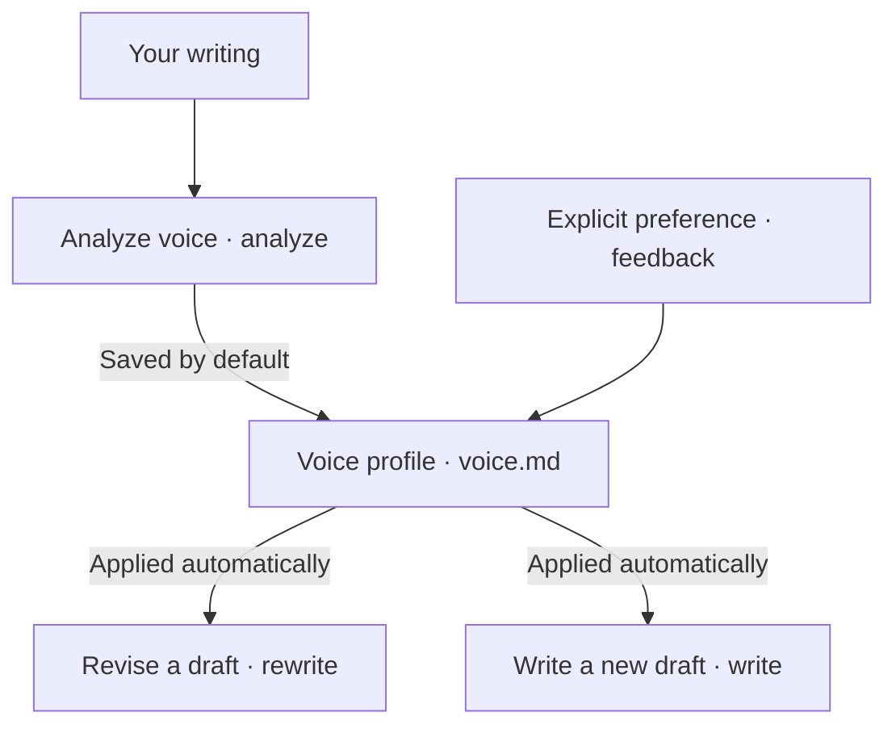

# Humanizer KR

English | [한국어](README.md)



Edit Korean drafts in Codex or Claude Code while **preserving meaning and facts**. Save a voice profile from your writing and use it to revise drafts or write new ones.

[Example](#example) · [Codex install](#install-in-codex) · [Claude Code install](#install-in-claude-code) · [Use](#use) · [Personalization](#style-analysis-and-personalized-writing)

## Example

| Stage | Sentence |
| --- | --- |
| **Before** | 아래 내용을 확인하시어 이용에 참고 부탁드립니다. |
| **After** | 아래 내용을 확인해 주세요. |

## Install in Codex

```bash
codex plugin marketplace add hjongc/humanizer-kr --ref v0.3.1
codex plugin add humanizer-kr@humanizer-kr-marketplace
```

<details>
<summary>Install the skill directly</summary>

For a personal local install without plugin metadata, copy the skill folder into a Codex skills directory:

```text
skills/humanizer-kr/ -> ~/.codex/skills/humanizer-kr/
```

Restart Codex and invoke `$humanizer-kr`.

</details>

## Install in Claude Code

Add the repository as a Claude Code marketplace, then install the plugin:

```bash
claude plugin marketplace add https://github.com/hjongc/humanizer-kr.git
claude plugin install humanizer-kr@humanizer-kr-marketplace
```

<details>
<summary>Pin the Claude Code version</summary>

For an immutable install, clone this repository at `v0.3.1` and add the local path:

```bash
git clone --branch v0.3.1 https://github.com/hjongc/humanizer-kr.git
claude plugin marketplace add ./humanizer-kr
claude plugin install humanizer-kr@humanizer-kr-marketplace
```

</details>

## Use

**Start with a draft.** Restart your app after installation, then paste a request like one below.

### Codex

```text
Use $humanizer-kr to make this Korean draft sound natural:
[paste text]
```

### Claude Code

```text
/humanizer-kr:humanizer-kr Polish this Korean draft and preserve its meaning.
[paste text]
```

<details>
<summary>Ask for a second pass or a review</summary>

**Review and refine the rewritten draft**

```text
Use $humanizer-kr. Rewrite this, then review the result once and improve it again:
[paste text]
```

**Review the writing without rewriting it**

```text
Use $humanizer-kr to review this Korean copy for AI-like phrasing:
[paste text]
```

</details>

### Style analysis and personalized writing

| Goal | Task | Input → Output |
| --- | --- | --- |
| Understand your style | `analyze` | Your writing → An evidence-based voice profile |
| Edit a draft | `rewrite` | Draft and sample or profile → Revised draft |
| Write in your voice | `write` | Brief, facts, and voice profile → A new draft |
| Refine your preferences | `feedback` | Explicit preference → Updated profile · Correction and reason → Saved example |



> [!IMPORTANT]
> **Style analysis saves your samples and profile locally by default.** Add “Analyze without saving” to keep the request read-only.

<details>
<summary>Personalization commands</summary>

**Claude Code**

```text
/humanizer-kr:analyze [your writing or file path]
/humanizer-kr:rewrite [draft and voice sample, or use the saved profile]
/humanizer-kr:write [topic, reader, purpose, and supplied facts]
/humanizer-kr:feedback [explicit preference, before/after correction with reason, or undo]
```

**Codex**

```text
Use $humanizer-kr. Analyze my Korean writing style: [my writing]
Use $humanizer-kr. Rewrite this in my voice: [draft and sample]
Use $humanizer-kr. Write in my saved voice. Topic: [...]. Reader: [...]. Purpose: [...]. Facts: [...].
```

**Save feedback or undo**

```text
/humanizer-kr:feedback Save this preference: concise sentences with meaningful connectors.
/humanizer-kr:feedback Before: [...] / After: [...] / Reason: [...]
/humanizer-kr:feedback Undo the last feedback profile change.
```

Create a voice profile before saving feedback. Explicit preferences update the profile. Corrections and comparison choices are recorded as examples. Undo preserves later manual edits or profile rebuilds.

</details>

<details>
<summary>Profile storage and precedence</summary>

Analysis saves samples and a derived `voice.md` unless explicitly opted out. An explicit storage selection wins; otherwise update the active profile directory (project first, then personal). With no existing profile, start in `~/.humanizer-kr/`. Store raw writing in the selected directory's `samples/`. If personal storage is explicitly selected while a project profile exists, that project profile still takes precedence when writing in this project. Each observed feature records its sample ID, a short privacy-safe quote, genre scope, and evidence sufficiency. A one-off phrase is not an always-use preference, and a work-email sample does not establish a chat style.

Later rewrites and new compositions through this skill automatically load and apply `voice.md`; the user does not need to select their voice again. Current instructions can override or disable it. Raw samples are not reloaded. Adding samples rebuilds it from all saved samples. Profiles remain hand-editable; existing profiles still work. Consider ignoring `.humanizer-kr/` for project storage. Before returning output, check voice alignment, factual preservation, and sample copying separately. This workflow is not proof of voice fidelity; see [evaluation guidance](https://github.com/hjongc/humanizer-kr/blob/main/evals/README.md).

</details>

<details>
<summary>Audit local files</summary>

Use the audit helper to review AI-writing tells in Korean files. The basic audit and `--quality` results are review signals, not grounds for adding actions or specificity that the source does not contain.

```bash
python3 skills/humanizer-kr/scripts/audit_korean_text.py --quality --genre product-copy --fail-on-findings examples/product-copy.after.ko.md
```

To check every public after example with its genre-specific quality pass, run:

```bash
python3 skills/humanizer-kr/scripts/audit_korean_text.py --after-examples
```

</details>

## Examples

| Genre | Before | After |
| --- | --- | --- |
| Product copy | [Before](examples/product-copy.before.ko.md) | [After](examples/product-copy.after.ko.md) |
| Public notices | [Before](examples/public-notice.before.ko.md) | [After](examples/public-notice.after.ko.md) |
| Support email | [Before](examples/support-email.before.ko.md) | [After](examples/support-email.after.ko.md) |
| Proposals | [Before](examples/proposal.before.ko.md) | [After](examples/proposal.after.ko.md) |
| Product docs | [Before](examples/docs.before.ko.md) | [After](examples/docs.after.ko.md) |
| Social posts | [Before](examples/social-post.before.ko.md) | [After](examples/social-post.after.ko.md) |

The after examples include multiple rewrite candidates such as a safe version, a warmer version, and a shorter version. They are reference rewrites, not the only acceptable answers.

## Editing criteria

<details>
<summary>Five editing groups and 20 patterns</summary>

Humanizer KR does not treat the 20 patterns as a flat banned-word list. The skill rewrites through five editing groups, then uses the 20 patterns as Korean-specific observation signals inside those groups.

1. Evidence and claim strength
2. Translationese and vocabulary density
3. Actors and verbs
4. Register and relationship
5. Structure and rhythm

The 20 documented patterns are:

| Group | Patterns |
| --- | --- |
| Evidence and claim strength | inflated praise, vague authority, knowledge-gap disclaimers, generic positive conclusions, stacked hedging |
| Translationese and vocabulary density | translation-like connectors, English-first word choice, synonym cycling |
| Actors and verbs | nominalized Korean, passive or availability chains |
| Register and relationship | register drift, chatbot artifacts, honorific padding, sycophantic or fake-candid openers |
| Structure and rhythm | over-structured chatbot formatting, punctuation and parenthesis clutter, heading warm-ups, bold-label lists, change-anchored documentation, uniform cadence and slogan rhythm |

</details>

## What it is not

Humanizer KR is not an AI detector. The audit script flags patterns that deserve review; it does not prove that a text was written by AI. Do not use this skill to hide plagiarism, impersonate another real person's authorship, or bypass academic, hiring, or compliance integrity checks.

## Limitations

- It is built for AI-written drafts. On text a person already wrote, it can still reword sentences and shift their meaning slightly, so do not run it on human-written text.
- The skill improves wording and register; it does not verify factual claims unless the user provides sources.
- The audit script is conservative and pattern-based. Clean output does not guarantee polished Korean.
- Claude Code plugin behavior can vary by installed Claude Code version. Validate locally before publishing to a Claude marketplace.

## External sources

- The Korean Ministry of Government Legislation's *Easy-to-Understand Statutes Drafting Standards*, 10th edition (revised and expanded), is the source for sentence rules S1–S13.
- The Ministry of Culture, Sports and Tourism and National Institute of Korean Language's *Guide to Writing Easy Public Language* (2014), and NIKL's *Public Language Made Easy at a Glance*, revised edition (2022), are the sources for public-language rules N1–N13.

## Project editing guides

- [Korean source rules](skills/humanizer-kr/references/korean-source-rules.md) summarizes the external sources, their verification status, and how the project applies them.
- [Rewriting playbook](skills/humanizer-kr/references/rewriting-playbook.md) describes how to edit each pattern and when to stop.

## License

MIT
