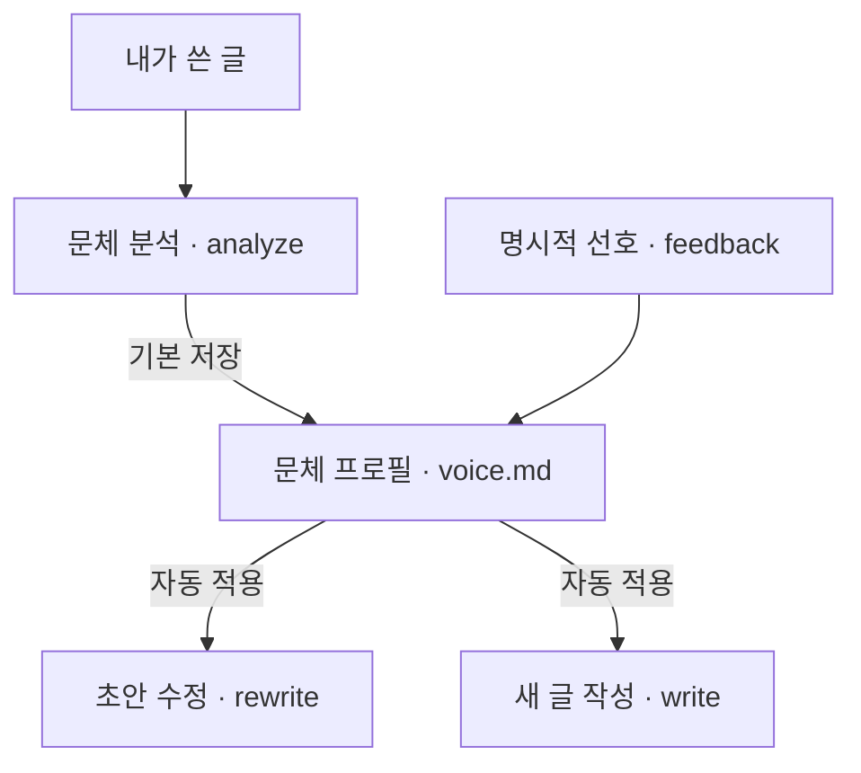

# Humanizer KR

[English](README.en.md) | 한국어


Codex와 Claude Code에서 **원문의 뜻과 사실을 지키며** 번역투와 과한 높임을 다듬습니다. 내가 쓴 글로 문체를 저장해 초안 수정과 새 글 작성에 적용할 수 있습니다.

[작동 예시](#작동-예시) · [설치](#설치) · [사용법](#사용법) · [문체 맞춤](#문체-분석과-맞춤-글쓰기)

## 작동 예시

| 단계 | 문장 |
| --- | --- |
| **수정 전** | 아래 내용을 확인하시어 이용에 참고 부탁드립니다. |
| **수정 후** | 아래 내용을 확인해 주세요. |

## 설치

### Codex 플러그인

```bash
codex plugin marketplace add hjongc/humanizer-kr --ref v0.3.1
codex plugin add humanizer-kr@humanizer-kr-marketplace
```

### Claude Code 플러그인

```bash
claude plugin marketplace add https://github.com/hjongc/humanizer-kr.git
claude plugin install humanizer-kr@humanizer-kr-marketplace
```

<details>
<summary>Claude Code에서 버전 고정하기</summary>

태그를 고정해서 쓰고 싶다면 로컬에 태그를 지정해 clone한 뒤 그 경로를 marketplace로 추가하세요.

```bash
git clone --branch v0.3.1 https://github.com/hjongc/humanizer-kr.git
claude plugin marketplace add ./humanizer-kr
claude plugin install humanizer-kr@humanizer-kr-marketplace
```

</details>

<details>
<summary>Codex 스킬 수동 설치</summary>

플러그인 metadata 없이 스킬만 쓰려면 아래 폴더를 Codex 스킬 디렉터리에 복사합니다.

```text
skills/humanizer-kr/ -> ~/.codex/skills/humanizer-kr/
```

</details>

## 사용법

**초안 하나로 시작하기.** 설치 후 사용하는 앱을 다시 시작하고 아래처럼 요청하세요.

### Codex

```text
$humanizer-kr 원문의 뜻을 지키면서 이 초안을 자연스럽게 다듬어줘.
[한국어 초안]
```

### Claude Code

```text
/humanizer-kr:humanizer-kr 원문의 뜻을 지키면서 이 초안을 자연스럽게 다듬어줘.
[한국어 초안]
```

<details>
<summary>한 번 더 다듬기 또는 문체만 검토하기</summary>

**다듬은 결과를 다시 검토하고 싶을 때**

```text
Use $humanizer-kr. Rewrite this, then review the result once and improve it again:
[고칠 한국어 초안]
```

**수정 없이 어색한 표현만 짚고 싶을 때**

```text
Use $humanizer-kr to review this Korean copy for AI-like phrasing:
[검토할 한국어 문장]
```

</details>

### 문체 분석과 맞춤 글쓰기

| 하고 싶은 일 | 작업 | 입력 → 결과 |
| --- | --- | --- |
| 내 문체 파악하기 | `analyze` | 내가 쓴 글 → 근거가 담긴 문체 프로필 |
| 초안 다듬기 | `rewrite` | 초안과 샘플 또는 프로필 → 수정문 |
| 내 문체로 새 글 쓰기 | `write` | 주제·독자·목적·사실과 프로필 → 새 글 |
| 문체 선호 반영하기 | `feedback` | 명시한 선호 → 프로필 갱신 · 수정문과 이유 → 사례 기록 |



> [!IMPORTANT]
> **문체 분석은 기본적으로 글 샘플과 프로필을 로컬에 저장합니다.** 저장을 원치 않으면 “저장하지 말고 분석만 해줘”라고 덧붙이세요.

<details>
<summary>문체 맞춤 명령 예시</summary>

**Claude Code**

```text
/humanizer-kr:analyze [내가 쓴 글 또는 파일 경로]
/humanizer-kr:rewrite [고칠 초안과 문체 샘플, 또는 저장된 프로필 사용 요청]
/humanizer-kr:write [주제, 독자, 목적, 사용할 사실]
/humanizer-kr:feedback [명시적 선호, 수정 전·후와 이유, 또는 되돌리기]
```

**Codex**

```text
Use $humanizer-kr. 내 문체 선호로 저장해줘: 간결한 문장과 필요한 연결어를 좋아해.
Use $humanizer-kr. 내 문체를 분석해줘: [내가 쓴 글]
Use $humanizer-kr. 내 문체로 고쳐줘: [초안과 문체 샘플]
Use $humanizer-kr. 저장한 내 문체로 써줘. 주제: [주제], 독자: [독자], 목적: [목적], 사실: [사용할 정보]
```

**피드백 저장과 되돌리기**

```text
/humanizer-kr:feedback 간결한 문장을 선호하지만 필요한 연결어는 살려줘.
/humanizer-kr:feedback 수정 전: [원문] / 수정 후: [수정문] / 이유: [수정 이유]
/humanizer-kr:feedback 마지막 프로필 변경을 되돌려줘.
```

피드백을 쓰려면 먼저 문체 프로필을 만드세요. 명시한 선호만 문체 규칙에 반영합니다. 이후 수동 편집이나 재분석이 있었다면 되돌리기가 그 변경을 덮어쓰지 않습니다.

</details>

<details>
<summary>프로필 저장 위치와 적용 우선순위</summary>

분석 시 저장 위치를 지정하면 그 위치를 사용합니다. 지정하지 않으면 현재 적용 중인 프로필 위치(프로젝트 우선)를 갱신하고, 기존 프로필이 없을 때만 개인용 `~/.humanizer-kr/`에 처음 저장합니다. 선택된 위치의 `samples/`에 글마다 원문을 보관하고 `voice.md`를 만듭니다. 개인 저장을 명시했어도 기존 프로젝트 프로필이 있으면 이 프로젝트에서는 프로젝트 프로필이 계속 우선합니다. 프로필에는 특징별 샘플 출처, 개인정보를 제외한 짧은 인용, 장르 범위와 근거 충분 여부를 기록합니다. 한 번 나온 표현을 상시 선호로 등록하지 않고, 업무 메일의 말투를 다른 장르에 일반화하지 않습니다.

분석 결과인 `voice.md`는 이후 이 스킬로 글을 수정하거나 새로 쓸 때 자동으로 불러와 적용합니다. 매번 “내 문체로”라고 지정할 필요가 없으며, 원본 샘플은 다시 읽지 않습니다. 현재 요청에서 다른 문체를 지정하거나 프로필 사용을 제외하면 그 요청을 우선합니다. 샘플을 추가하면 전체 저장 샘플에서 프로필을 다시 추출합니다. 프로필은 직접 수정할 수 있고, 프로젝트 저장 시 `.humanizer-kr/`를 `.gitignore`에 추가하는 편이 좋습니다. 기존 프로필도 계속 사용할 수 있습니다.

결과를 내기 전에 문체 특징과 다시 대조하고, 사실 보존과 샘플 문장 복사 여부를 별도로 확인합니다. 문체 재현 품질이 검증됐다는 뜻은 아니며, 비교 평가 방법은 [평가 안내](https://github.com/hjongc/humanizer-kr/blob/main/evals/README.md)를 참고하세요.

</details>

<details>
<summary>로컬 파일 점검 명령</summary>

로컬 파일에서 AI 문체 신호를 살펴보려면 audit script를 씁니다. 기본 점검과 `--quality` 결과는 검토 신호이며, 원문에 없는 행동이나 구체성을 추가하는 근거로 삼지 않습니다.

```bash
python3 skills/humanizer-kr/scripts/audit_korean_text.py --quality --genre product-copy --fail-on-findings examples/product-copy.after.ko.md
```

공개 after 예시 전체가 기본 점검과 장르별 품질 점검을 통과하는지 확인하려면 아래 명령을 씁니다.

```bash
python3 skills/humanizer-kr/scripts/audit_korean_text.py --after-examples
```

</details>

## 예시 파일

| 장르 | 수정 전 | 수정 후 |
| --- | --- | --- |
| 제품 카피 | [수정 전](examples/product-copy.before.ko.md) | [수정 후](examples/product-copy.after.ko.md) |
| 공지문 | [수정 전](examples/public-notice.before.ko.md) | [수정 후](examples/public-notice.after.ko.md) |
| 지원 이메일 | [수정 전](examples/support-email.before.ko.md) | [수정 후](examples/support-email.after.ko.md) |
| 제안서 | [수정 전](examples/proposal.before.ko.md) | [수정 후](examples/proposal.after.ko.md) |
| 제품 문서 | [수정 전](examples/docs.before.ko.md) | [수정 후](examples/docs.after.ko.md) |
| 소셜 포스트 | [수정 전](examples/social-post.before.ko.md) | [수정 후](examples/social-post.after.ko.md) |

각 after 파일에는 `기본 정돈`, `더 자연스러운 버전`, `짧은 버전`처럼 여러 출력 후보를 넣었습니다. 예시 출력은 정답 하나가 아닙니다. 같은 사실을 보존하더라도 독자, 매체, 목적에 따라 더 나은 표현은 달라질 수 있습니다.

<details>
<summary>지원 이메일 수정 과정 보기</summary>

**수정 전**

> 안녕하세요. 좋은 질문입니다. 아래와 같이 정리해 드립니다.
>
> 사용자님께서는 설정 메뉴에 접속하시어 알림 옵션을 확인하시고, 필요하신 경우 변경 진행 부탁드립니다. 또한 해당 이슈는 온보딩 과정에서 발생할 수 있는 부분이므로 이용에 참고 부탁드립니다.

**첫 수정**

> 안녕하세요.
>
> 설정 메뉴에서 알림 옵션을 확인해 주세요. 필요하면 알림 설정을 바꿀 수 있습니다.
>
> 이 문제는 처음 설정할 때 발생할 수 있습니다.

**아직 어색한 점**

- `필요하면 알림 설정을 바꿀 수 있습니다`는 가능 표현이 남아 있어 안내가 조금 흐립니다.
- 원문에 있던 `이슈`, `온보딩`, `참고 부탁드립니다` 같은 표현은 줄었지만, 지원 이메일로는 첫 안내가 조금 길게 느껴집니다.

**최종 수정**

> 안녕하세요.
>
> 설정 메뉴에서 알림 옵션을 확인해 주세요. 필요하면 알림 설정을 바꿔 주세요.
>
> 이 문제는 처음 설정할 때 발생할 수 있습니다.

챗봇식 인사와 과한 높임을 덜었습니다. 알림 설정을 확인하고 필요하면 변경하라는 안내와, 처음 설정할 때 문제가 생길 수 있다는 설명을 살렸습니다.

</details>

## 편집 기준

한국어 글을 다섯 가지 기준으로 봅니다. **근거와 주장 강도**, 번역투와 어휘, 주체와 동사, 말투와 관계, 구조와 리듬입니다.

<details>
<summary>20개 패턴과 수정 전·후 예시 보기</summary>

스킬은 20개 패턴을 낱말 금지 목록처럼 다루지 않습니다. 먼저 아래 5개 구분으로 문장을 읽고, 각 구분 안에서 반복되는 신호를 찾습니다. `혁신적인` 같은 단어 하나만 보고 바로 고치지는 않습니다. 근거 없는 칭찬, 모호한 권위, 포괄적 결론이 함께 나오면 "근거와 주장 강도" 문제로 보고 문장을 작게 고칩니다.

### 1. 근거와 주장 강도

주장이 근거보다 커지거나 확인되지 않은 효과를 그럴듯하게 포장할 때 나타나는 패턴입니다. 기대감보다 확인된 변화와 한계를 먼저 씁니다.

| # | 패턴 | Before | After |
| --- | --- | --- | --- |
| 1 | 과한 홍보 표현 | `검색어를 입력하면 관련 문서를 한 화면에서 비교할 수 있는 혁신적인 기능으로 최적화된 사용자 경험을 제공합니다.` | `검색어를 입력하면 관련 문서를 한 화면에서 비교할 수 있습니다.` |
| 2 | 모호한 권위 | `많은 전문가들은 로그에서 장애 지점을 바로 확인하는 방식이 중요하다고 말합니다.` | `이 방식은 장애 지점을 로그에서 바로 확인할 때 유용합니다.` |
| 3 | 근거 부족 회피문 | `정보는 제한적이지만 중요한 역할을 한 것으로 보입니다.` | `현재 초안에는 역할을 확인할 근거가 없습니다.` |
| 4 | 포괄적 긍정 결론 | `다음 업데이트에서 검색 필터와 저장 기능을 먼저 개선하며 앞으로의 행보가 기대됩니다.` | `다음 업데이트에서는 검색 필터와 저장 기능을 먼저 개선합니다.` |
| 5 | 헤징 과다 | `반복 입력 시간을 줄이는 데 상당히 긍정적인 영향을 줄 수 있을 것으로 보입니다.` | `반복 입력 시간을 줄일 수 있습니다.` |

### 2. 번역투와 어휘 밀도

영어식 연결, 외래어 남용, 같은 대상을 매번 다른 말로 부르는 습관을 다룹니다. 표지어를 줄이고 실제 관계를 문장 안에 넣습니다.

| # | 패턴 | Before | After |
| --- | --- | --- | --- |
| 6 | 번역투 연결어 | `또한, 이를 통해 사용자는 필요한 정보를 더 빠르게 찾고 헤매는 시간을 줄일 수 있습니다.` | `사용자는 필요한 정보를 더 빨리 찾고 덜 헤맵니다.` |
| 7 | 영어 우선 단어 | `핵심 인사이트와 니즈를 기반으로 어프로치를 설계합니다.` | `확인한 내용과 사용자의 필요를 바탕으로 접근 방식을 정합니다.` |
| 8 | 동의어 돌려쓰기 | `사용자는 설정을 저장하고, 고객은 결과를 확인하며, 이용자는 알림을 받습니다.` | `사용자는 설정을 저장하고 결과와 알림을 확인합니다.` |

### 3. 주체와 동사성

한국어 문장이 명사 덩어리와 수동 표현으로 굳어질 때 보는 구분입니다. `-화`, `-성`, `가능합니다`, `제공됩니다`를 줄이고 누가 무엇을 하는지 동사로 씁니다.

| # | 패턴 | Before | After |
| --- | --- | --- | --- |
| 9 | 명사화된 표현 | `반복 업무 효율성 향상을 위한 자동화 기능 제공이 가능합니다.` | `반복 업무를 자동으로 처리해 시간을 줄입니다.` |
| 10 | 수동ㆍ가능 표현 반복 | `설정을 변경하면 결과는 자동으로 저장됩니다.` | `설정을 바꾸면 시스템이 결과를 자동으로 저장합니다.` |

### 4. 말투와 관계

독자와의 거리감이 흔들리거나, 챗봇 답변처럼 과하게 친절해질 때 보는 구분입니다. 한 가지 말투를 정하고 끝까지 유지합니다.

| # | 패턴 | Before | After |
| --- | --- | --- | --- |
| 11 | 말투 흔들림 | `확인합니다. 다음 단계로 넘어가요. 사용자는 저장해야 한다.` | `확인합니다. 다음 단계로 이동합니다. 사용자는 저장해야 합니다.` |
| 12 | 챗봇 답변 흔적 | `물론입니다. 아래와 같이 정리해 드립니다. 알림은 설정에서 끌 수 있습니다.` | `알림은 설정에서 끌 수 있습니다.` |
| 13 | 과한 높임 | `사용자님께서는 아래 내용을 확인하시어 이용에 참고 부탁드립니다.` | `아래 내용을 확인해 주세요.` |
| 14 | 가짜 솔직함 | `솔직히 말하면, 사용자가 바로 이해하는 것이 핵심입니다.` | `사용자가 바로 이해할 수 있어야 합니다.` |

### 5. 구조와 리듬

제목, 목록, 굵은 라벨, 괄호, 짧은 슬로건 문장이 글의 흐름을 대신할 때 보는 구분입니다. 설명을 억지로 세 갈래로 나누거나 같은 박자로 반복하지 않습니다.

| # | 패턴 | Before | After |
| --- | --- | --- | --- |
| 15 | 챗봇식 구조화 | `## 핵심 요약\n이 글의 핵심은 다음 세 가지입니다.\n- 반복 업무 감소\n- 빠른 처리\n- 쉬운 설정` | `반복 업무를 줄이고 설정을 더 빨리 마칩니다.` |
| 16 | 괄호ㆍ기호 과밀 | `사용자(관리자/운영자)의 반복 업무 효율(생산성)을 높입니다.` | `관리자와 운영자의 반복 업무를 줄입니다.` |
| 17 | 제목 뒤 워밍업 | `## 설정\n설정 방법을 살펴보겠습니다.\n알림을 끄려면 설정에서 알림 옵션을 해제합니다.` | `## 설정\n알림을 끄려면 설정에서 알림 옵션을 해제합니다.` |
| 18 | 굵은 라벨 목록 | `- **속도:** 페이지 속도가 개선되었습니다.` | `- 페이지가 더 빨리 열립니다.` |
| 19 | 변경 내역 앵커 | `기존 수동 입력 방식을 개선해 입력 내용 자동 저장 기능이 추가되었습니다.` | `입력한 내용은 자동으로 저장됩니다.` |
| 20 | 슬로건 리듬 | `빠릅니다. 간단합니다. 강력합니다. 기본 템플릿에 팀이 자주 쓰는 항목을 추가할 수 있습니다.` | `기본 템플릿으로 시작하고, 팀이 자주 쓰는 항목만 추가할 수 있습니다.` |

</details>

## 사용 범위

AI 초안의 표현을 점검하고 다듬는 데 쓰세요. 사람이 쓴 글을 다듬을 때도 원문과 대조해 의미가 유지됐는지 확인하세요. 문체 점검 결과는 AI 작성 여부를 판정하는 근거가 될 수 없습니다. 표절 은폐, 작성자 사칭, 학업·채용·심사 절차 우회에는 사용하지 마세요.

## 외부 출처와 참고 자료

- 법제처 「알기 쉬운 법령 정비기준」 제10판(수정증보판): 문장 규칙 S1–S13의 출처
- 문화체육관광부·국립국어원 「쉬운 공공언어 쓰기 길잡이」(2014), 국립국어원 「(개정판) 한눈에 알아보는 공공언어 바로 쓰기」(2022): 공공언어 규칙 N1–N13의 출처
- [Wikipedia: Signs of AI writing](https://en.wikipedia.org/wiki/Wikipedia:Signs_of_AI_writing): AI 문체를 패턴 단위로 보는 접근 방식
- [blader/humanizer](https://github.com/blader/humanizer): README 구성과 패턴 문서화 방식의 참고 프로젝트

## 프로젝트 편집 가이드

- [한국어 출처와 적용 규칙](skills/humanizer-kr/references/korean-source-rules.md) — 외부 자료의 확인 상태와 출처별 규칙을 정리한 문서입니다.
- [윤문 가이드](skills/humanizer-kr/references/rewriting-playbook.md) — 패턴별 수정 방법과 필요한 부분만 고치는 원칙을 담았습니다.

<details>
<summary>버전 히스토리</summary>

- **0.3.1** - 명시적 문체 선호와 수정문·이유를 저장하는 `feedback` 커맨드와 안전한 되돌리기를 추가했습니다.
- **0.3.0** - 문체 분석·저장과 자동 적용, 분석·수정·새 글 작성 커맨드, 근거 기반 프로필과 문체 비교 평가를 추가했습니다.
- **0.2.0** - AI 문체 제거를 목표로 다시 맞추고, 의미 고정(Meaning Lock)과 최소 편집 원칙, 개인 문체 프로필, 법제처ㆍ국립국어원 기반 문장 규칙, audit `--source` 의미 검사를 추가했습니다.
- **0.1.10** - README 이미지를 제거하고 작동 예시를 Before/After 중심으로 간결하게 정리했습니다.
- **0.1.9** - audit script에 `--fail-on-findings`와 `--after-examples` 품질 게이트를 추가하고, 패키지 검증이 공개 after 예시의 기본ㆍ장르별 품질 점검을 함께 확인하도록 했습니다.
- **0.1.8** - README 첫 예시와 이미지, 출력 개선 루프를 추가하고 공개 README에서 maintainer용 섹션을 덜어냈습니다.
- **0.1.7** - README의 20개 패턴을 5개 핵심 구분별 Before/After 표로 재정리했습니다.
- **0.1.6** - 릴리즈 문서와 체크리스트가 `--release` 검증과 manifest/CHANGELOG 버전 기준을 따르도록 정리했습니다.
- **0.1.5** - 20개 패턴을 평평한 체크리스트가 아니라 5개 핵심 분류 안의 관찰 신호로 재정리했습니다.
- **0.1.4** - `blader/humanizer` README 흐름을 참고해 한국어 README를 재구성했습니다. 한국어 AI 문체 패턴을 20개로 확장하고, 지원 이메일ㆍ제안서ㆍ제품 문서ㆍ소셜 포스트 예시를 추가했습니다.
- **0.1.3** - 한국어 README를 기본 문서로 전환했습니다.
- **0.1.2** - 한국어 README와 GitHub 공개 문서 흐름을 보강했습니다. Claude Code 설치 문서를 HTTPS marketplace 기준으로 정리했습니다.
- **0.1.1** - Claude Code marketplace metadata를 추가하고, installable plugin package에 root marketplace metadata가 섞이지 않도록 동기화를 보강했습니다.
- **0.1.0** - Codex/Claude 공용 스킬, 한국어 문체 지침, source-grounding reference, 예시, 감사 스크립트, 패키지 검증을 추가했습니다.

</details>

## 라이선스

MIT
